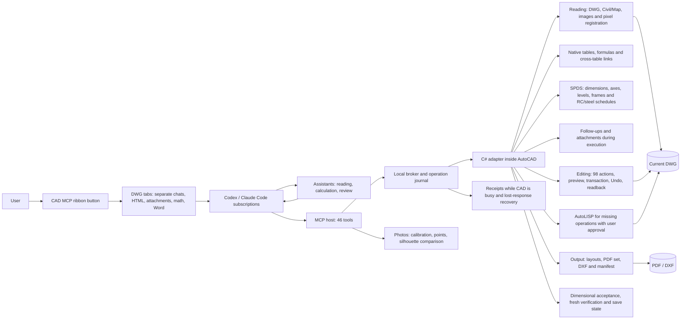

# CAD MCP 0.10.0 capabilities and roadmap

Since 0.7.0, measurable acceptance checks run before commit and roll back invalid ordinary batches; `cad_verify` rereads objects afterward. Operation status is available outside the DWG queue, and lost replies do not trigger duplicate edits. Photos can be calibrated using known points and agent-supplied outlines compared with final views. This is not automatic full 3D reconstruction. See [contracts, examples, and limits](result-verification.md).

C# runs inside AutoCAD; MCP/providers connect through a local broker. Edits return entities and revision. Native operations include arbitrary polygonal 3D meshes, spatial curves, extrusion, sweep, revolve, and solid Booleans. Layouts support viewports, plot settings, and title blocks; batch publishing produces PDFs/manifests. Rasters use WCS control points; view captures are calibrated separately. Civil has a limited catalog/TIN operations; Map reads coordinate systems/object data. Special Civil/Map functions had not been validated in live vertical products. SPDS/GOST and published PDF contents require separate checks.

| Implementation | Useful published idea | Our status |
|---|---|---|
| [beiming183-cloud/AutoCAD-MCP](https://github.com/beiming183-cloud/AutoCAD-MCP) | Geometry readback, topology, broader 3D operations, final-file verification | Transactions/readback, sweep/Booleans, `cad_review` topology, PDF/DXF rereading. |
| [U-C4N/Autocad-MCP](https://github.com/U-C4N/Autocad-MCP) | Layouts/templates/standards, critique pass, schedules, specialized tool packs | Viewports/schedules and dimension/font/field/sheet-number checks implemented; a GOST/SPDS rules contract remains needed. |
| [Slacker-LLC/autocad-mcp](https://github.com/Slacker-LLC/autocad-mcp) | Explicit units, parameter checks, actual AutoCAD capture | DWG units/validation, real previews, control-point pixel calibration. |
| [zymorel/autocad-mcp-community](https://github.com/zymorel/autocad-mcp-community) | Advertised Civil surfaces/alignments/profiles, Map/geodata | October 2026 source review found Civil/Map modules nonfunctional and no license; no code used. Our Civil calls are checked against 2024–2027 signatures. |
| [HorizunGroup/horizun-civil3d-mcp](https://github.com/HorizunGroup/horizun-civil3d-mcp) | Typed Civil plugin, live findings, signature dumps | Dumps support offline call checks; alignment curves and named styles/parts implemented. |

An October 2026 review of 77 repositories and 379 forks led to user-approved Lisp, edit previews, everyday 2D operations, topology/release checks, outlines/takeoff, change feeds, Civil alignment curves, and agent evaluation (`benchmarks/`). These additions were built/unit-tested; that review did not establish live AutoCAD validation.

Next validation: compare PDFs with DWG layouts, independent raster checkpoints, and live Civil/Map DWGs with OD, alignments, and networks. Then extend precise C# editing for alignments/profiles/networks/Map OD. AutoLISP remains a fallback where Autodesk lacks a suitable managed API. [Autodesk .NET blocks/layouts guide](https://help.autodesk.com/cloudhelp/2027/PLK/OARX-DevGuide-Managed/files/GUID-DF67671C-101D-4917-808B-DD2C5BE3C7E9.htm); [Civil requires AeccDbMgd/AecBaseMgd](https://help.autodesk.com/cloudhelp/2025/ENU/Civil3D-DevGuide/files/GUID-267E68C8-AD2D-4F7F-87DF-831018D56CDB.htm).
